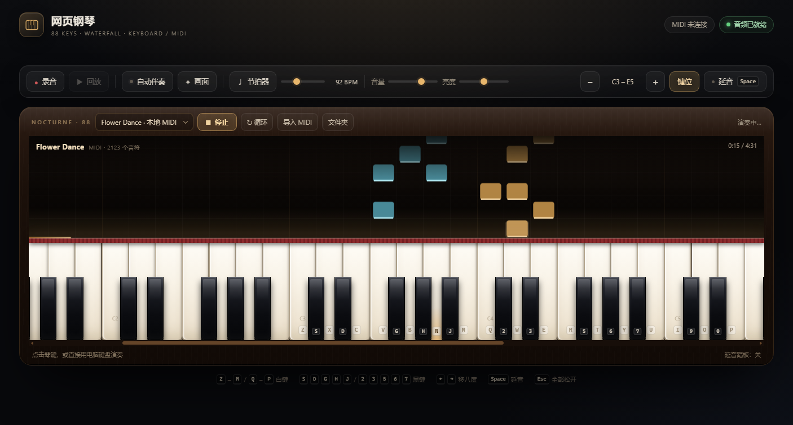
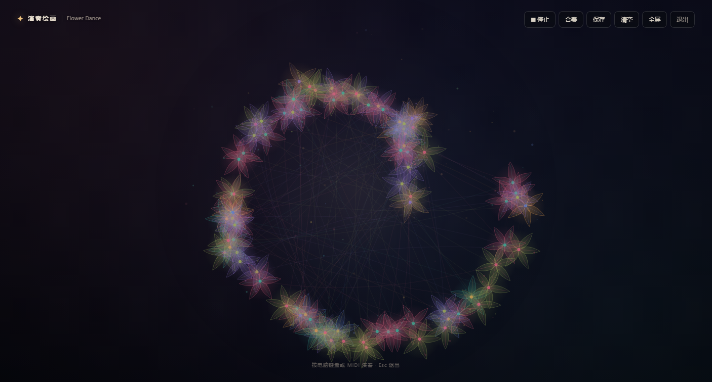

# 网页钢琴 · 瀑布流 / 演奏绘画

一个开箱即用的 88 键网页钢琴，带瀑布流（piano roll）乐谱、自动伴奏和演奏绘画。双击 `index.html`，用 Edge / Chrome 打开即可弹奏，不需要安装，也不需要联网。

## 在线体验

[https://zh080521.github.io/web-piano/](https://zh080521.github.io/web-piano/)

## 预览





## 电脑键盘怎么弹

| 区域 | 白键 | 黑键 |
| --- | --- | --- |
| 低音区 | `Z` `X` `C` `V` `B` `N` `M` | `S` `D` `G` `H` `J` |
| 高音区 | `Q` `W` `E` `R` `T` `Y` `U` `I` `O` `P` | `2` `3` `5` `6` `7` `9` `0` |

- `←` / `→`：整体降低 / 升高一个八度
- `Space`（按住）：延音踏板
- `Esc`：停止播放、松开所有音符
- 鼠标点击琴键时，点击位置越靠下，力度越大

## 瀑布流演奏

- 在琴头选择曲目，点击「演奏」，音符会从上方向琴键落下，命中时琴键高亮并发声。
- 「循环」可以反复练习同一段；播放时键盘仍然可以自由弹奏，适合跟练。
- 录音 / 回放、节拍器、延音、音量、音色亮度都可以正常使用；开始录音时，正在播放的曲目会先停止。

## 自动伴奏

点工具栏的「自动伴奏」开关，它会自动补上低音和琶音：

- 不弹也会先跑一个温柔的循环；你弹旋律时，它会跟着你按住的和弦、最近弹过的音判断调性，在下一小节切换和弦
- 伴奏速度跟随工具栏的 BPM（和节拍器共用）
- 默认是 A 小调；多弹几个音后，它会尝试跟着你的调走
- 和播放曲目、录音、回放互斥：开始这些操作时会自动关闭伴奏，避免和声打架
- 自动伴奏只用于实时演奏，不写入录音；录音里只有你自己弹的音符

## 演奏绘画 / 展示

点工具栏的「画面」进入全屏演奏绘画，钢琴和页面 UI 会隐藏，适合投屏、录屏或纯欣赏：

- 每个音符按音高、力度生成一朵花，连续的音符之间长出丝带；画面会一直累积
- 顶部控件：播放 / 停止当前曲目、合奏开关、保存 PNG、清空、全屏、退出
- 约 3.6 秒无操作后控件自动隐藏；移动鼠标或点按屏幕重新显示
- `Esc` 退出；退出后画作会保留，下次进入继续画
- 电脑键盘和 MIDI 键盘在展示模式里仍然可以演奏；手机可以点「合奏」让伴奏自己画，或播放一首曲目
- 绘画是页面自带的 Canvas 实现，不依赖 Folia

## 内置曲目

- **Flower Dance**：由项目维护者提供的 `Flower Dance.mid`，已嵌入 `music/flower-dance-midi.js`，页面启动后默认选中。2123 个音符，约 4 分 31 秒。
  - 这份 MIDI 本身的音域是 A2–E4，听起来会比原曲低一些，可能是简化或低八度版本；如果需要，可以再加移调按钮。
  - 它没有踏板事件，播放器会给音符加一点释放尾音，让琶音不至于太干。
  - 这个 MIDI 由项目维护者提供，维护者确认已获得公开使用授权；如需转载或再分发，请先向权利人确认。
- **晨光**：为这个页面写的原创小曲（84 BPM），不涉及任何现有歌曲的转谱，可作为没有 MIDI 时的示例。

## 导入自己的 MIDI

点击「导入 MIDI」，或者直接把 `.mid` / `.midi` 文件拖进页面。支持批量：

- 文件选择框里按住 Ctrl / Shift 一次选多个文件
- 直接把多个 MIDI 文件一起拖进页面
- 点「文件夹」可以选择整个目录，自动导入里面所有 `.mid` / `.midi`（Edge / Chrome 支持）
- 导入时会显示进度，结束后提示成功和失败数量；曲目会按文件名排序加入下拉框

其他说明：

- 支持 Standard MIDI File Format 0 / 1，PPQ 时间格式
- 会读取多轨音符、速度变化和 CC64 延音踏板
- 单个文件上限 15 MB；暂不支持 Format 2 和 SMPTE 时间格式

### 永久保存

导入成功的曲目会保存到浏览器本机的 IndexedDB（数据库 `web-piano-library`）：

- 刷新页面、关闭再打开浏览器，曲目会自动恢复，并记住上次选择的曲目
- 重复导入同一个文件会被识别并跳过
- 选中导入的曲目后，琴头会出现「删除」按钮，可以把它从本机曲库移除
- 内置的 Flower Dance 和《晨光》是页面自带的，不占用曲库，也不会被删除按钮删掉
- 清除浏览器站点数据、使用无痕模式或换一个浏览器，本机曲库不会保留

如果浏览器禁用了 IndexedDB，导入仍会成功，但只会保留在当前页面，并提示“未能永久保存”。

**关于版权曲目**：Flower Dance 的 MIDI 来自你本机提供的文件，我只做了本地接入，没有从网上抓谱或转写。其他版权曲目同理，请使用你自己有权使用的 MIDI。

## 关于外接 MIDI 键盘

浏览器通常要求 Web MIDI 运行在安全来源下。如果双击打开后 MIDI 设备连不上，可以在这个目录里启动一个本地服务器：

```powershell
python -m http.server 8765
```

如果 `python` 不可用，试试：

```powershell
py -m http.server 8765
```

然后访问 <http://localhost:8765/>，再点击右上角的「MIDI 未连接」连接设备。

## 浏览器建议

最新版 Microsoft Edge、Google Chrome、Safari 或 Firefox。首次按键/点击后音频才会启动，这是浏览器的自动播放限制。
